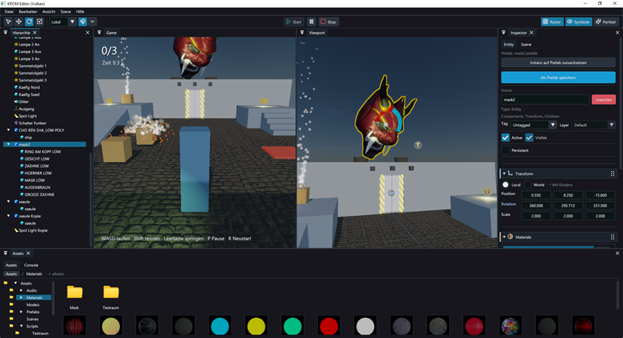
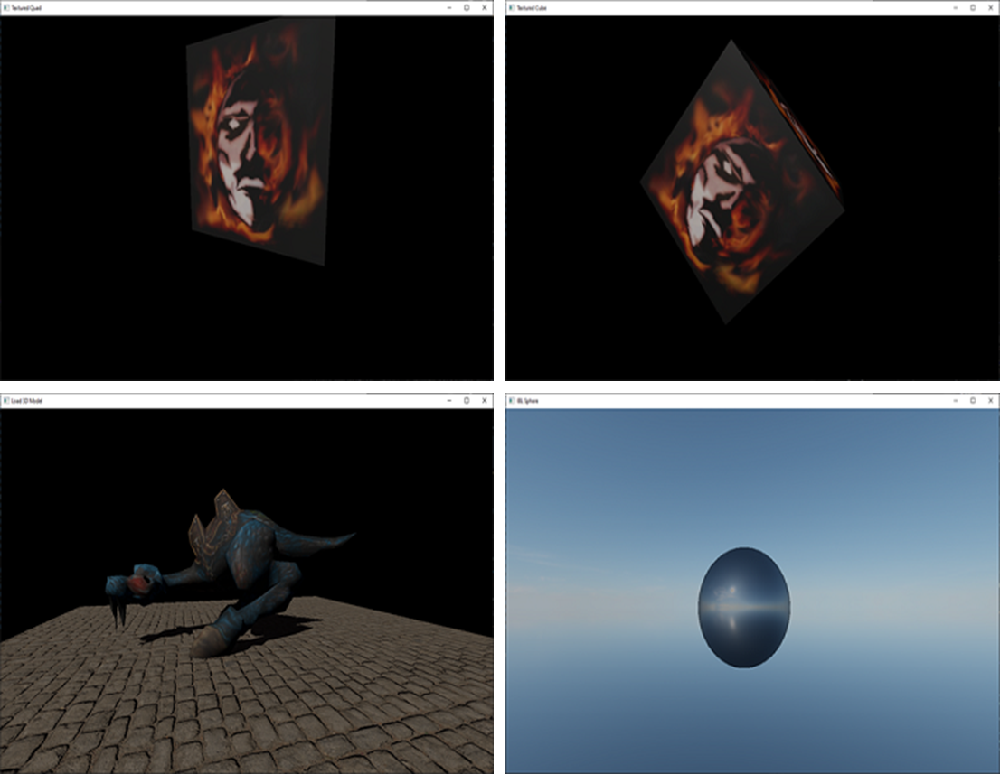

## in development

Current version: 0.9 – The engine is still under development. See [Release Notes](doc/RELEASE_NOTES.md).

Main page: https://oyname.github.io/index.html

KROM Engine is a modern C++20 engine focused on render architecture and extensibility, built around proven game development patterns such as ECS, RenderGraph, and a plugin-based backend system. Its architecture is designed to keep the core clean and backend-agnostic, while platform-, renderer-, and feature-specific logic is moved into dedicated AddOns.

This AddOn model makes it possible to integrate and evolve backends such as DX11, DX12, OpenGL, Vulkan, or Metal without polluting the engine core with API-specific code. In addition, rendering features such as Forward, PBR, or Post-Processing can also be implemented as modular AddOns. Post-Processing is treated not as API-specific logic, but as a rendering feature built on top of the engine’s abstractions, while the actual execution is still handled by the respective graphics backends.

This keeps the engine more flexible, easier to maintain, and significantly better suited for long-term growth.

## Getting started

Requirements: Windows 10/11, Visual Studio 2022 with the C++ workload, and the [Vulkan SDK](https://vulkan.lunarg.com/) for the Vulkan targets. The editor also discovers standalone Visual Studio Build Tools through `vswhere`. Install the C++ CMake tools component, or provide CMake and Ninja in `PATH`. If a tool is not found automatically, set its path under *Editor Settings → External Tools → Build and shader tools* (Visual Studio folder, CMake, Ninja, `dxc.exe`, `glslangValidator.exe`); *Check tools* shows what will be used.

1. Open the repository folder in Visual Studio (*File → Open → Folder*) and pick the `x64-Debug` or `x64-Release` configuration. The first configure needs an internet connection for Jolt (see below).
2. Build everything (*Build → Build All*). Executables end up in `out/build/<config>/bin/`.

## KROM Editor

KROM Editor is the visual development environment included with KROM Engine. It brings scene creation, asset management, and gameplay testing into one workspace, making it easier to build projects and work with the engine.

The editor includes:

- **Visual scene editing:** Arrange objects in the scene viewport with tools for moving, rotating, and scaling.
- **Hierarchy and inspector:** Organize scene objects and edit their components and properties.
- **Asset and material tools:** Browse project assets, configure materials and lighting, and work with reusable prefabs.
- **Gameplay testing:** Run scenes directly in the editor and view the game alongside the scene viewport.
- **C++ scripting:** Add custom gameplay logic to scene objects.

The included **DemoProject** provides a playable scene to explore the editor and engine features.

### Editor and demo project

Start `krom_editor_vulkan` (or `krom_editor_dx11` / `krom_editor_opengl`). On the start screen open `projects/DemoProject`.
The demo project contains all textures, models, sounds and scripts it needs. The scene **Testraum** is a small playable level (character controller, physics, trigger, sounds, particles, custom shaders); press **Start** in the toolbar to play it directly in the editor.

## Code-only examples

These examples use the engine from plain C++ without the editor. Each one is built for every enabled backend (`_dx11`, `_vulkan`, `_opengl`); their assets live in `assets/` and are copied next to the executables.

| Example | Source | What it shows |
| --- | --- | --- |
| `adapter_enum_*` | [examples/adapter_enum.cpp](examples/adapter_enum.cpp) | Lists the available GPUs/adapters of the backend |
| `minimal_window_*` | [examples/minimal_window.cpp](examples/minimal_window.cpp) | Smallest possible app: a window and keyboard input |
| `textured_quad_*` | [examples/textured_quad.cpp](examples/textured_quad.cpp) | A lit, textured quad turning around its axis |
| `textured_cube_*` | [examples/textured_cube.cpp](examples/textured_cube.cpp) | A cube built vertex by vertex, textured and rotating |
| `load_3d_model_*` | [examples/load_3d_model.cpp](examples/load_3d_model.cpp) | A glTF model on a PBR floor, a custom ECS component/system and a WASD camera |
| `ibl_sphere_*` | [examples/ibl_sphere.cpp](examples/ibl_sphere.cpp) | Image-based lighting and skybox from an HDR environment |

## Third-party libraries

KROM Engine uses the following open-source libraries and tools. Many thanks to their authors and contributors.

| Library | Used for | License | Integration | In exported games |
| --- | --- | --- | --- | --- |
| [Dear ImGui](https://github.com/ocornut/imgui) | Editor interface and docking | MIT | Included in `third_party/imgui` | No (editor only) |
| [cgltf](https://github.com/jkuhlmann/cgltf) (with [jsmn](https://github.com/zserge/jsmn)) | Importing glTF and GLB models | MIT | Included in `third_party/cgltf` | Yes |
| [stb_image](https://github.com/nothings/stb) | Loading images and HDR textures | MIT or Public Domain | Included in `third_party/stb` | Yes |
| [stb_truetype](https://github.com/nothings/stb) | Baking fonts for in-game text | MIT or Public Domain | The copy bundled with Dear ImGui (`imstb_truetype.h`) | Yes |
| [Jolt Physics](https://github.com/jrouwe/JoltPhysics) | Physics simulation and collision detection | MIT | Fetched by CMake when physics is enabled | Yes |
| [miniaudio](https://github.com/mackron/miniaudio) | Audio playback | Public Domain or MIT-0 | Fetched by CMake when audio is enabled | Yes |
| [Lucide](https://lucide.dev) | Icon font (`assets/fonts/lucide.ttf`) | ISC | Included in `assets/fonts` | Yes (engine assets) |
| [DirectX Shader Compiler](https://github.com/microsoft/DirectXShaderCompiler) | HLSL to SPIR-V (Vulkan) and DXIL (DirectX 12) | University of Illinois/NCSA | `dxc.exe` from the Vulkan SDK, found at runtime | Vulkan/DX12 builds, in `tools/` |
| D3DCompiler (`d3dcompiler_47.dll`) | HLSL to DXBC for DirectX 11 | Microsoft Windows SDK terms | Copied from the Windows SDK redist folder | DX11 builds |
| Microsoft Visual C++ runtime | C++ standard library DLLs | Microsoft Visual Studio terms | Copied app-locally for release runtimes | Yes |
| [GLFW](https://github.com/glfw/glfw) | Window creation and input for the optional GLFW platform layer | zlib | Used when available and enabled | Only if linked |
| [shaderc](https://github.com/google/shaderc) / [glslang](https://github.com/KhronosGroup/glslang) | GLSL to SPIR-V compilation | Apache 2.0 / BSD-style | Optional CMake dependency, or `glslangValidator` as an external tool | Only if linked |

The license texts of everything compiled into a game are collected in [`licenses/`](licenses/), together with an overview in [`licenses/README.txt`](licenses/README.txt). The original notices are also kept with each library.

### Shipping a game

The editor export (*File → Export Project*) writes a `licenses/` folder next to the game executable. It contains the overview, the KROM Engine license and the license text of every library and tool listed as shipped above. Most of these licenses require their copyright notice to be distributed with the game, so keep this folder when you package or upload the game.

If you add libraries to your own project, add their license texts to `licenses/` as well and list them in `licenses/README.txt`.

## License

KROM Engine is licensed under the [Mozilla Public License 2.0](LICENSE). You can use it in commercial and closed-source games. Changes to the engine's own files have to stay available under the MPL 2.0; your game code, scripts and assets are not affected. A game built with KROM Engine has to tell its players where the engine's source code can be found; the `licenses/README.txt` that the export writes does this.

## Note: physics (Jolt) is downloaded on first configure

The physics AddOn (`addons/physics`) uses [Jolt Physics](https://github.com/jrouwe/JoltPhysics) (v5.5.0). Jolt is not part of this repository; CMake fetches it via `FetchContent` the first time the project is configured, so an internet connection is required once. The sources end up in the build folder (`out/build/<config>/_deps/`), not in the repository. Deleting the build folder triggers a new download.

To build without physics (no download, no Jolt), configure with `-DKROM_WITH_PHYSICS=OFF`. Scenes and prefabs that contain physics components still load; they are just not simulated.
